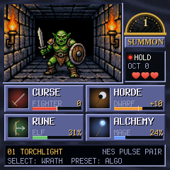

# GARGOYLE

An 8-bit drone synth for the M-VAVE FM-1 by **swtdr34mz**: drones made from the sound chips of the old home computers,
consoles and DOS games – the pulse waves and the noise register of the NES, the 4-bit waves of the Game Boy, the
arpeggio chords and the ring modulator of the C64, the dirty polynomial counters of the Atari POKEY, the FM of the
AdLib card, the 1-bit PC speaker. In a dungeon: every page is a room with its own monster.

  

## Install

Download the `.fwsc` from [Releases](https://github.com/swtdr34mz-afk/GARGOYLE/releases) and install it like any FM-1
firmware (The Firmware Hub, or the M-Flasher). Manuals: [Deutsch](docs/HANDBUCH.md), [English](docs/MANUAL.md).

## Play

One knob, one parameter (like FIKH-S), six pages:

| Button | Page | K1 | K2 | K3 | K4 |
|---|---|---|---|---|---|
| HOME | SUMMON | CURSE (ring / sync, FM) | HORDE (octaves / detune) | RUNE (wave, duty, table) | ALCHEMY (per algorithm) |
| HOME 2× | GROOVE | DENSITY | BREATH | DISTANCE | TEMPO |
| HOME 3× | SETUP | LEVEL | HUMAN | FOLLOW | TUNE |
| FX | ECHO | ECHO (mix) | HAUNT (feedback, left ping-pong) | DECAY (duller, grainier) | DEPTH (time) |
| ENV | RITUAL | TORCH (low / high pass) | PORTAL (±24 semitones) | AWAKEN (attack) | SLUMBER (release) |
| EDIT | LORE | CREEP (glide) | WANDER (drift) | BITS (16 .. 1 bit) | VOLUME |
| LFO | SPELL | AGE (sample rate down to 2 kHz) | VIBRATO | SPEED (vibrato, arpeggios, patterns) | WIDTH |

SELECT is **WRATH**, one macro over everything for live play (past half the dragon appears). PRESET picks the
algorithm, ALGORITHM is QUEST (its variants, coarse), REC is FATE (dice; held 1 s: deep). PLAY: HOLD, ARP: FREEZE (the
echo holds), SEQ held: factory sound, GLO: levels, SAVE + key / SEL + key: 8 snapshots. MIDI: notes, pitch bend,
CC 1 RUNE, CC 70–73 CURSE HORDE RUNE ALCHEMY, CC 75 WRATH, clock / start / stop for the GROOVE.

**The 16 algorithms:** TORCHLIGHT (NES pulse pair), CRYPT CHOIR (Game Boy waves), GOBLIN CHORDS (C64 arpeggio),
DRAGON BREATH (NES noise), PC SPEAKER (1-bit beeper), POKEY CURSE (Atari polys), SID RITUAL (C64 ring / sync), ADLIB
HALL (OPL FM), BEHOLDER (tracker vibrato), TREASURE (FM bells), SKELETON MARCH (triangle and ticks), MAGE TOWER (wave
morph), THRONE OF BONES (octave arpeggio), PIT OF DOOM (divider logic), WIND OF ABYSS (filtered noise), SPELLBOOK
(random notes). No reverb: an echo that stores 8 bits, every repeat a little grainier.

**GROOVE:** ten styles of dungeon noises as the old consoles made them (square, 4-bit triangle, the noise register,
16 volume steps, 60 frames a second, 6 bits): HEARTBEAT, FOOTSTEPS, DRIPS, CHAINS, WINGS, RITUAL, BELL, BONES, RUMBLE,
TORCH, tuned to the drone, with a pump (BREATH).

## Building

`X0X_FONTSET=terminus python3 fm1-base/tools/build.py . --host`, then `build/host/gargoyle_host tests/basic.txt
build/host` (also `groove`, `algos`, `snaps`, `battery`). The pictures: `python3 tools/gen_art.py` → art.h.

## Licence

MPL-2.0. The serif font is Liberation Serif (SIL OFL 1.1). See [CREDITS.md](CREDITS.md).
