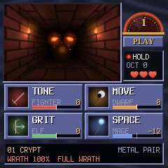

# GARGOYLE

A drone synth for the M-VAVE FM-1 by **swtdr34mz**, made for playing live. It has the sound of
[FIKH-S](https://github.com/swtdr34mz-afk/FIKH-S) (its twenty-two algorithms, the DUNGEON / REFLEKTA processor and the
ambient reverb), but not its menus: the twenty-two algorithms are twenty-two rooms of a dungeon, and four macros do
the same in every room. Plus a **GROOVE** of dungeon noises instead of drums – a heartbeat, footsteps, chains, a
distant bell – tuned to the drone, with a soft pump that makes the drone breathe.

  

The look is inspired by the first-person dungeon games of the early 90s; everything is drawn from code (tools/gen_art.py), no artwork, logo or name of any game is used.

## Install

Download the `.fwsc` from [Releases](https://github.com/swtdr34mz-afk/GARGOYLE/releases) and install it like any FM-1
firmware (The Firmware Hub, or the M-Flasher). It runs on both FM-1 chips.
Manuals: [Deutsch](docs/HANDBUCH.md), [English](docs/MANUAL.md).

## Play

| Control | What it does |
|---|---|
| Keys | the drone's root note (mono, last key wins, velocity); OCT- / OCT+ the octave |
| **HOME: PLAY** | **TONE** dark – bright, **MOVE** still – churning, **GRIT** clean – broken, **SPACE** dry – endless |
| HOME 2×: GROOVE | DENSITY, BREATH (the pump), DISTANCE (near – far), TEMPO (30–140 BPM) |
| HOME 3×: SETUP | LEVEL, HUMAN (randomness), FOLLOW (tuned to the root), TUNE (±12 semitones) |
| EDIT: DEEP | COLOR, GLIDE, WIDTH, LEVEL |
| FX | MODE (DREAM, DARK, RISE, LIGHT, RAIN), X (vibrato, octave down, swell, shimmer, diffuse), ECHO, AGE |
| SELECT | **WRATH**: one macro over everything, made for live – the dragon wakes up (cross modulation, saturation, boiling feedback, metal, more reverb), 4 a detent |
| PRESET | the room (1–22) |
| ALGORITHM | SCAN (coarse); on the GROOVE pages: the style |
| PLAY | HOLD (on from the start): the drone stays, keys only change the root |
| REC | DICE (held 1 s: deep dice); on the GROOVE pages: GROOVE on / off |
| ARP | FREEZE: delay and reverb hold what they have |
| SEQ (held 1 s) | the room back to its factory sound |
| GLO | VOL: the output levels in the picture |
| SAVE / SAVE + key / SEL + key | save; store a snapshot on one of the first eight white keys; recall it |
| MIDI | notes on any channel, pitch bend ±2, CC 1 COLOR, CC 70–73 TONE, MOVE, GRIT, SPACE, CC 75 WRATH; clock, start, stop for the GROOVE |

Every macro has its **sweetspot** in the middle (the room's factory sound): turning through it, the knob stops there
for two detents. The macros move 2.5 a detent (7.5 when turned fast), so every detent is heard. Each room keeps its own
macros, DEEP, SEED and SCAN; FX and the GROOVE are the same for all rooms.

**GROOVE styles:** HEARTBEAT, FOOTSTEPS (they come closer and go), DRIPS, CHAINS, WINGS (they circle), RITUAL, BELL,
BONES, RUMBLE, TORCH. All synthesized, tuned to the note you play, a little late and uneven on purpose (HUMAN).

## Building

- Host build: `X0X_FONTSET=terminus python3 fm1-base/tools/build.py . --host`, then
  `build/host/gargoyle_host tests/basic.txt build/host` (also `groove`, `rooms`, `snaps`, `battery`).
- Firmware builds run on GitHub Actions on every push to `main`, pull requests and `v*` tags; every push to `main` also
  puts GARGOYLE in the browser: https://swtdr34mz-afk.github.io/GARGOYLE/emu/
- The sound core alone: `cc -O2 -Idsp -Ifm1-base/include tools/render_demo.c dsp/fikh_core.c -lm -o build/render_demo`
  (`GROOVE=0..9` in the environment adds the GROOVE).

## Licence

MPL-2.0. The serif font is Liberation Serif (SIL OFL 1.1). See [CREDITS.md](CREDITS.md).
